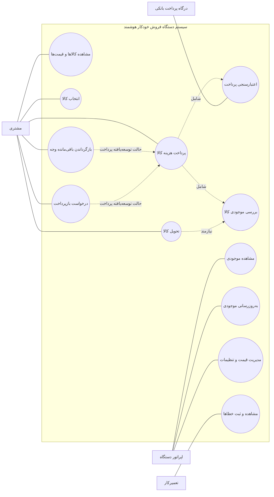

# نمودار Use Case سیستم دستگاه فروش خودکار هوشمند

این نمودار با Mermaid نوشته شده تا مستقیماً در GitHub نمایش داده شود. نمادگذاری آن **نمای ساده‌شده‌ای از Use Case** است؛ برای نمادگذاری رسمی UML، فایل PlantUML با پسوند `.puml` نیز در همین پوشه قرار دارد.

